#+TITLE:Assignment 2 Answers
#+DATE:10/18/2026
#+AUTHOR:Brandon Weathers
* Part A
Blackjack is a card game played between at least 2 participants.
For this example, there will only be two participants.
The first (and simpler) participant is the dealer.
The dealer doesn't has zero choices in the game, and is therefore not very interesting.
The second participant in the game is the player.
The player actively makes decisions.
The dealer gives two card to himself (one face up and one face down).
The dealer gives two card to the player, both of which are face up.
The player has two choices: to receive another card from the dealer (hit), or to _not_ receive another card from the dealer (stand).
The goal of the player is to hold cards who's sum is closer to 21 than the dealer's sum of cards.

Considering all previous conditions. The following can be said.
- Environment's goal: to acquire a sum that is closer to 21 than the dealer's sum.
- State/observation space: the player's sum and the dealer's face up card.
- Action space: the choice to hit or stand.
- Transition dynamics: the dealer gives another card to the player.
- Termination conditions
  - If the player acquires a natural (without hitting) sum of 21. A reward of +1.5 is given.
  - The dealer's sum is greater than 21. A reward of +1 is given.
  - The player's sum is greater than 21. A reward of -1 is given.
  - After the player stands, their sum is greater than the dealer's sum. A reward of +1 is given.
  - After the player stands, the dealer's sum is greater than the player's sum. A reward of -1 is given.
  - After the player stands, their sum is equal to the dealer's sum (push). A reward of +0 is given.
* Part B
I have created the blackjack CLI agent to implement the Q-learning algorithm. The following code snippet is found within the training function.
#+BEGIN_SRC python
if terminated or truncated:
    target = reward
else:
    target = reward + gamma * np.max(Q[next_state])

Q[state + (action,)] += alpha * (
    target - Q[state + (action,)]
)
#+END_SRC

Please run my BlackjackCLI.py script to train the algorithm yourself.
* Part C
My baseline parameters for AI training are:
- alpha = 0.1
- gamma = 0.95
- episilon = 1.0
- episilon_min = 0.05
- episilon_decay = 0.99999
- episodes = 300,000

The resulting graph shows how the algorithm preformed.
After quickly jumping to an average reward of -0.4 from the first few rounds, the algorithm slowly climbs to an average reward of 0.
There is a plateau from episodes 200,000 to 300,000.
Perhaps additional training from episode 200,000 is unnecessary?
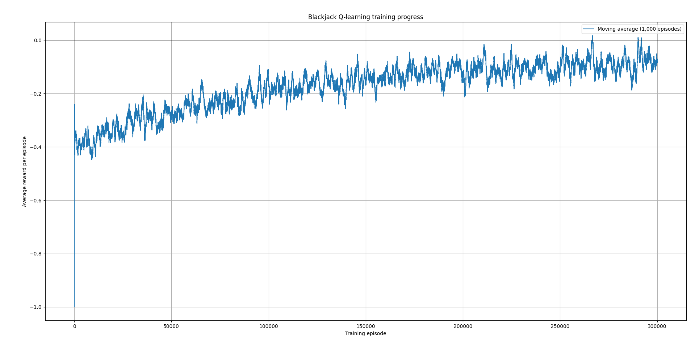
* Part D
All other parameters are the same as in part C except.
- In the first graph, alpha = 0.2
- In the second graph, alpha = 0.5
- In the third graph, alpha = 0.9

Generally speaking, it seems increasing the alpha parameters makes the variance larger.
In other words, the graph seems to be more volatile.
This is reasonable conclusion because the alpha parameter represents how valued new experience is compared to the sum of all previous experience.
** First Graph
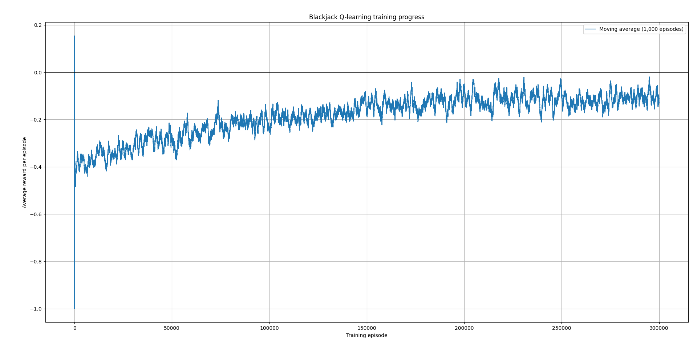
** Second Graph
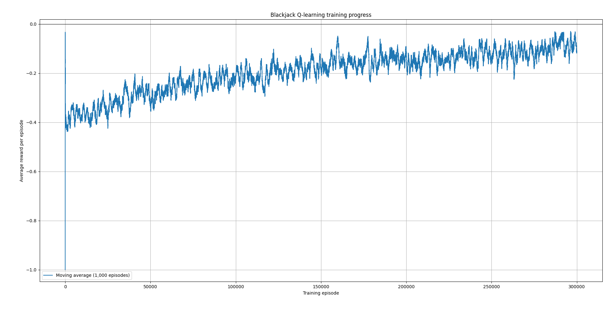
** Third Graph
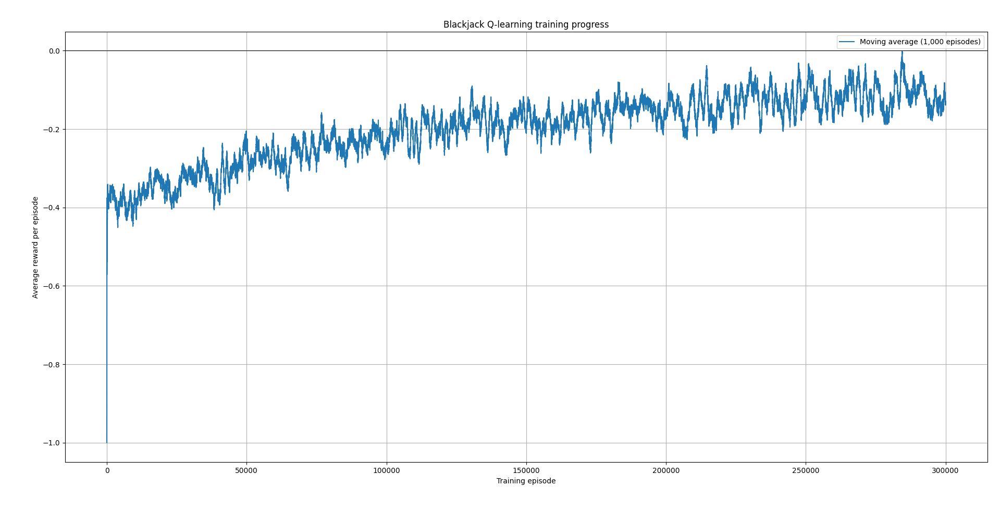
* Part E
All other parameters are the same as in part C except.
- In the first graph, gamma = 0.5
- In the second graph, gamma = 0.9
- In the third graph, gamma = 0.99
The first test yields a result that is very strange.
There seems to be very low variance and also very low reward.
This agent never once averages a -0.2 or above.
This is different than all other agents.
Other than that, it seems increasing the gamma factor allows the agent to be more stable.
** First Graph
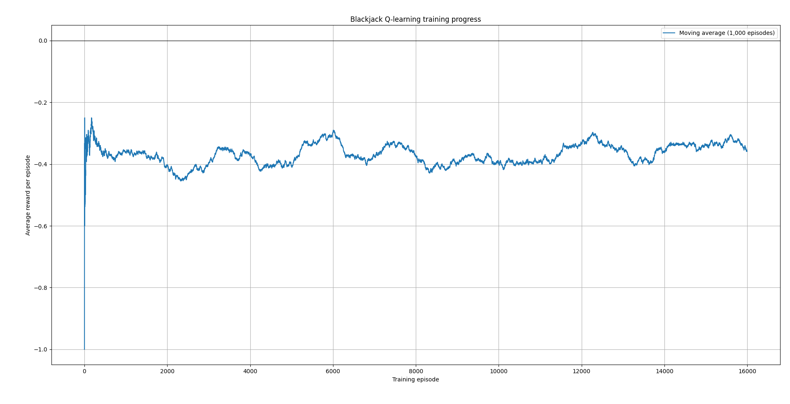
** Second Graph
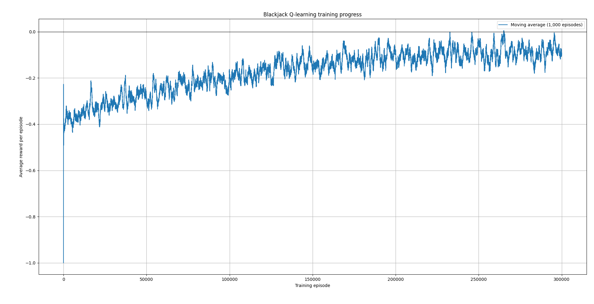
** Third Graph
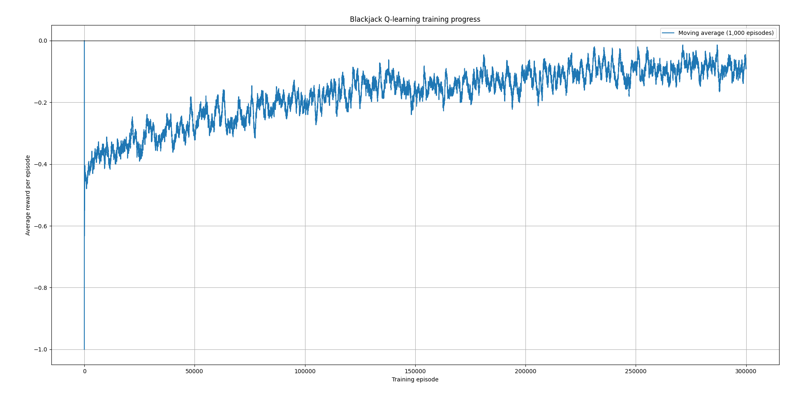
* Part F
Now, I will alter the episilon decay.
All other parameters are the same as in part C except.
- In the first graph, episilon decay = 0.9999
- In the second graph, episilon decay = 0.999
- In the third graph, episilon decay  = 0.99
In the second graph there is a very interesting outlier.
In the first few rounds the agent somehow averages +1.0!
Nevertheless, is averages out at a score between -0.2 and 0.
It seems that decreasing the episilon decay allows the agent to stabilize on an optimal strategy given minimal episodes.
** First Graph
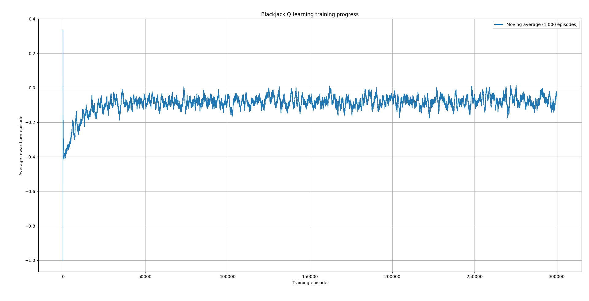
** Second Graph
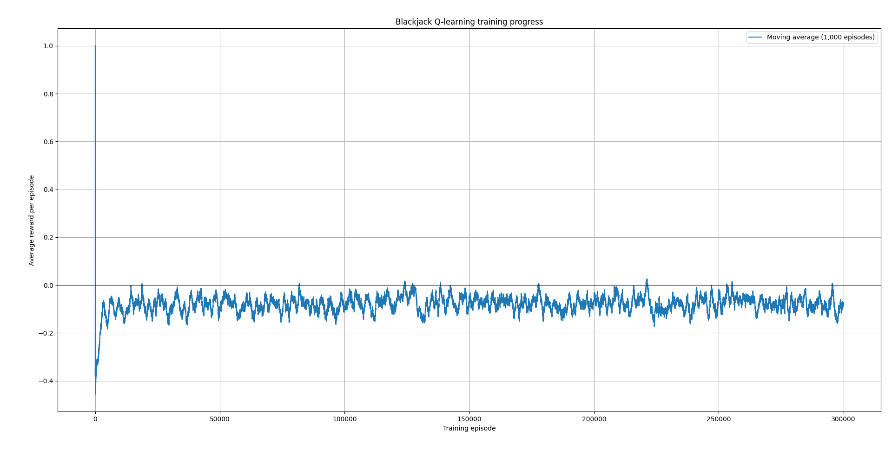
** Third Graph
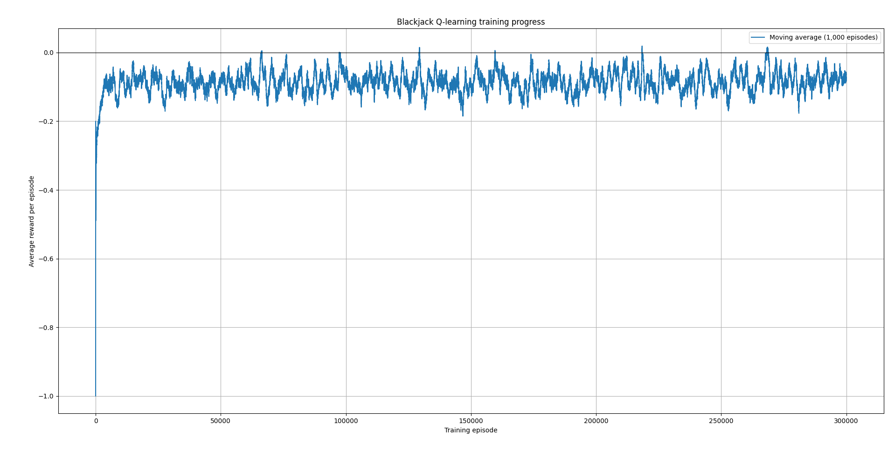
* Part G
To make my most powerful agent, I will take the best aspects from each other agent.
The following parameters will be used.
I have increased my episodes from 300,000 to 1,000,000.
In theory, this will allow the agent to get even more experience, which should result in better performance.
I will keep the alpha low. After all, we will have many changes to change
- alpha = 0.1
- gamma = 0.99
- episilon = 1.0
- episilon decay  = 0.99
- episilon_min = 0.05
- episodes = 1,000,000
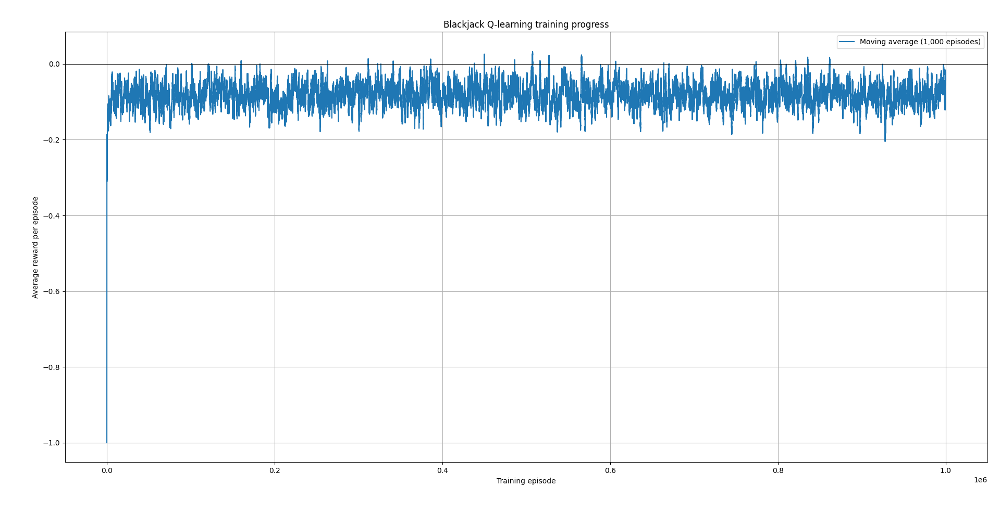

As you can see, my ultimate agent did well.
It quickly achieved a plateau of scoring well within -0.2 to 0 average points per episode.
* Part H
To implement noise, I have added an additional noise parameter (p) and changed my choose_action function to the following.
#+BEGIN_SRC python
def choose_action(state, episilon):
    if random.random() < episilon:
        action = env.action_space.sample()
    else:
        action = int(np.argmax(Q[state]))

    if random.random() < p:
        action = 1 - action

    return action
#+END_SRC

This changes the given choice to it's opposite.

To test different values of noise, I have conducted the following tests.
- In the first graph, noise = 0.0
- In the second graph, noise = 0.1
- In the third graph, noise = 0.25
It seems that agents struggle when their actions are somewhat randomized.
Noise limits the agent's average score.
For example, in the second graph the plateau is at -0.2 to -0.1.
I don't believe the learning rate is effected very much by the noise factor.
** First Graph
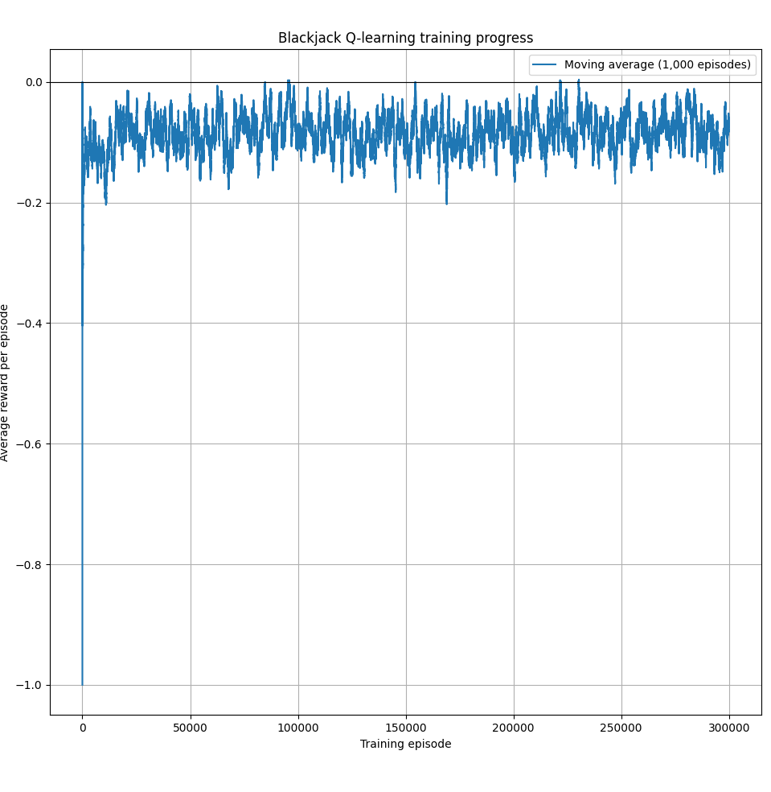
** Second Graph
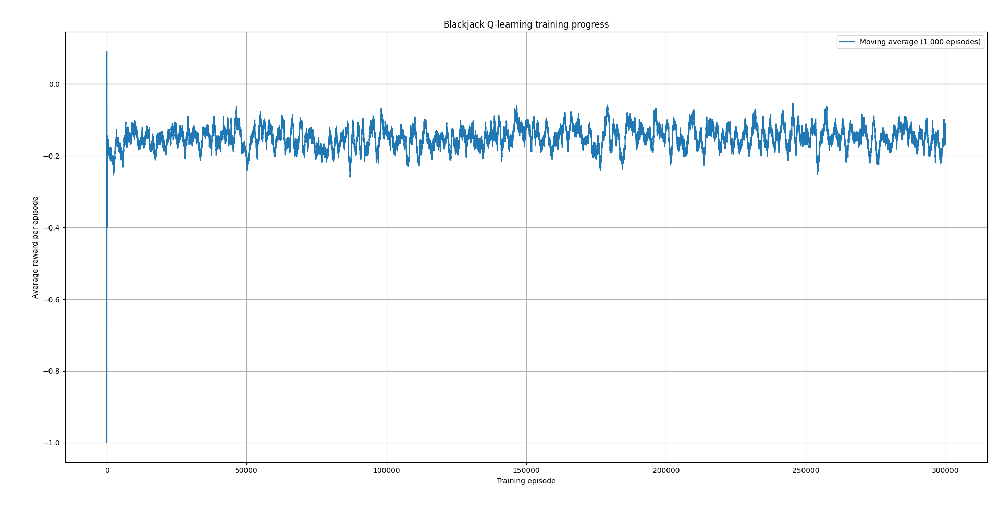
** Third Graph
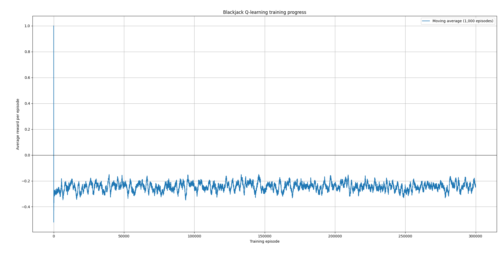
